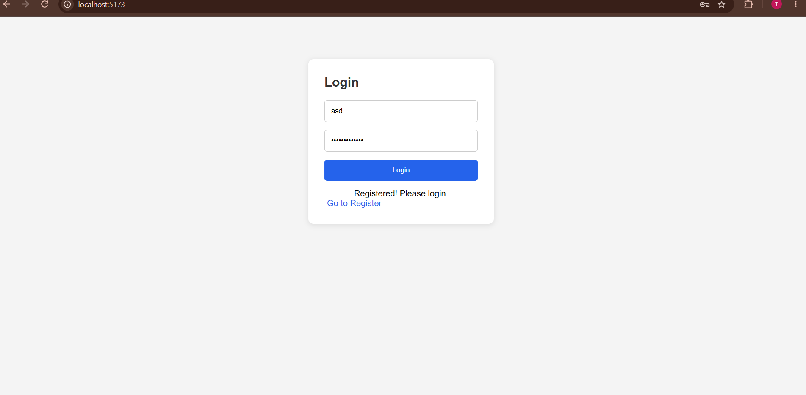
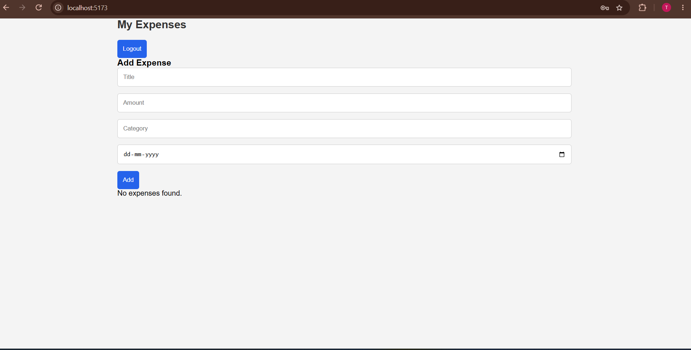
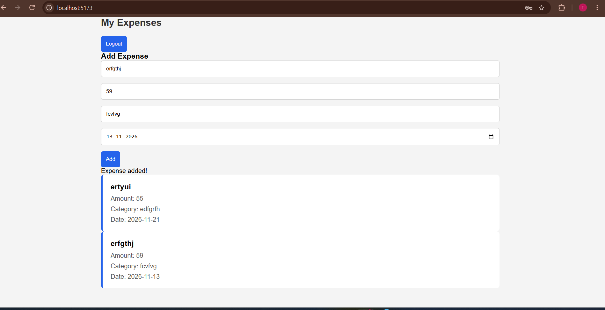
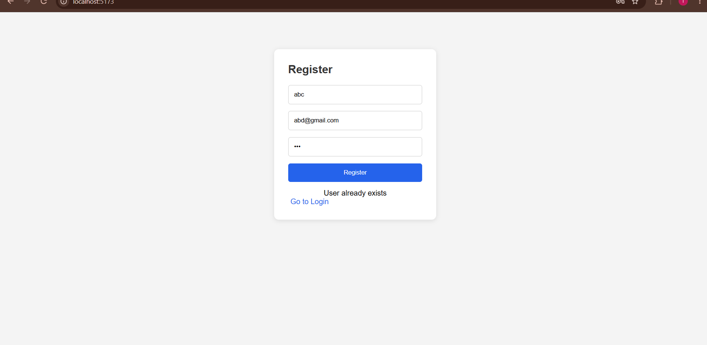
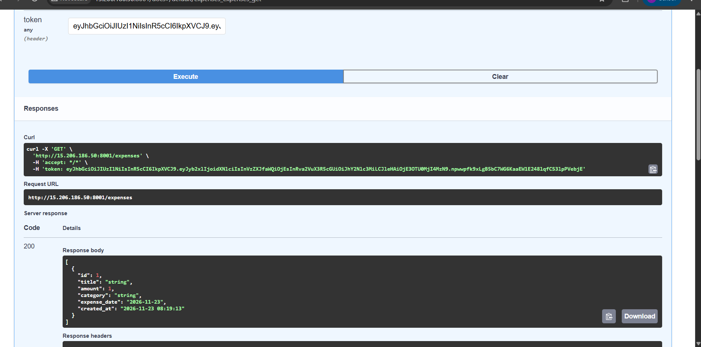
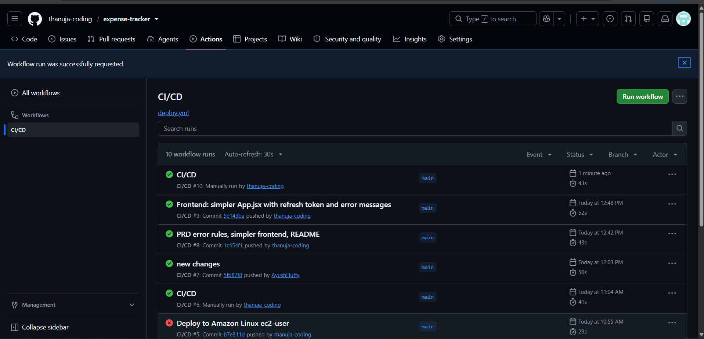

# Expense Tracker

## Problem Statement

People spend money every day on food, travel, bills and shopping, but most don't keep track of it. By the end of the month, they don't know where their money went.

Notes and spreadsheets are easy to forget and hard to keep private.

A simple, secure expense tracker. Each user creates an account, logs in, and records their expenses with a title, amount, category and date. Every user can see only their own expenses, so their data stays private.
## 1. Project and team

| Member | Endpoints built |
|---|---|
| Thanuja | E1 `GET /expenses`, E2 `POST /expenses`, database tables, Docker, CI/CD |
| Thamiksha Elluri | A1 `POST /register`, A2 `POST /login`, first frontend pages |
| Ayushman Anand | A3 `POST /refresh`, React frontend, EC2 setup |

**Tech stack:** FastAPI, SQLite (SQLAlchemy), JWT (PyJWT), Argon2 password hashing, React (Vite), Docker, GitHub Actions, AWS EC2.

## 2. Live app

- **API docs (Swagger):** http://15.206.186.50:8001/docs
- **Docker Hub image:** `gthanuja/expense`

## 3. How to run it

### Backend
```bash
cd Backend
python -m pip install -r requirements.txt
python -m uvicorn main:app --reload --port 8001
```
Open http://127.0.0.1:8001/docs

### Frontend
Run the backend first, then in a second terminal:
```bash
cd Frontend
npm install
npm run dev
```
Open http://localhost:5173

The backend address is set in one place: `API_URL` at the top of `Frontend/src/App.jsx`. Change it to `http://15.206.186.50:8001` to use the live EC2 backend.

### Docker
```bash
cd Backend
docker build -t gthanuja/expense:latest -f dockerfile .
docker run -d --name expense-app -p 8001:8001 gthanuja/expense:latest
```
Open http://127.0.0.1:8001/docs

### Deployment (CI/CD)
Every push to `main` runs `.github/workflows/deploy.yml`, which:
1. Builds the Docker image and pushes it to Docker Hub
2. Connects to EC2 over SSH
3. Pulls the new image, replaces the running container and starts it
4. Mounts `/home/ec2-user/expenses.db` into the container, so records survive redeploys

Credentials are stored only in GitHub Actions Secrets: `DOCKERHUB_USERNAME`, `DOCKERHUB_TOKEN`, `EC2_HOST`, `EC2_USER`, `EC2_SSH_KEY`.

## 4. API contract

Protected endpoints read the access token from the `token` header. The refresh endpoint reads the refresh token from the `refresh-token` header.

| # | Method | Path | Request body | Success |
|---|---|---|---|---|
| A1 | POST | `/register` | `{ "user_name", "email", "password" }` | 200 |
| A2 | POST | `/login` | `{ "email", "password" }` | 200 → `{ access_token, refresh_token }` |
| A3 | POST | `/refresh` | none (`refresh-token` header) | 200 → `{ access_token }` |
| E1 | GET | `/expenses` | none (`token` header) | 200 |
| E2 | POST | `/expenses` | `{ "title", "amount", "category", "expense_date" }` | 200 |

### Error rules

| Scenario | Status |
|---|---|
| Registering with an email that already exists | 409 |
| Missing or empty required fields | 422 |
| Invalid email format | 422 |
| Expense amount 0 or less | 422 |
| Incorrect email or password | 401 |
| Missing, invalid or expired access token | 401 |
| Invalid or expired refresh token | 401 |

## 5. Database

**Users**

| Column | Description |
|---|---|
| user_id | Primary key |
| user_name | Username |
| email | Email address (one account per email) |
| password | Argon2 password hash, never plain text |
| role | `user` or `admin` |

**expenses**

| Column | Description |
|---|---|
| id | Primary key |
| user_id | Foreign key → Users.user_id |
| title | Expense title |
| amount | Amount (must be greater than 0) |
| category | Category |
| expense_date | Date of the expense |
| created_at | When the record was created |


## 6. Screenshots

**Registration**

Registering a new user with username, email and password.

**Login**

Logging in with email and password.

**Dashboard**

The dashboard loads the logged-in user's expenses automatically after login.

**Error message**

Registering with an email that already exists shows "User already exists" (409).

**API working in /docs**

GET /expenses returning 200 with the user's expenses on the live EC2 link.

**GitHub Actions**

A green GitHub Actions run that built the Docker image and deployed it to EC2.
